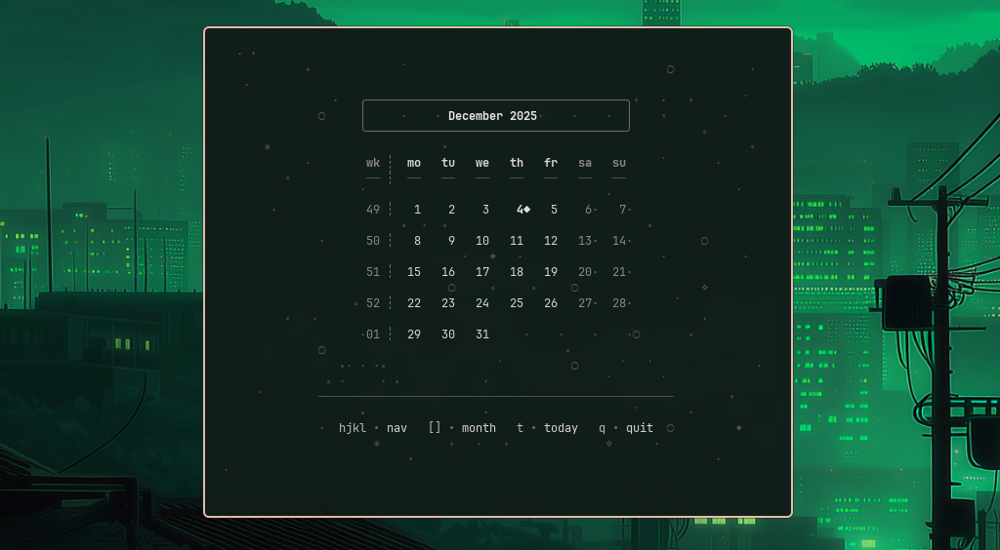

<div align="center">

```
                                     |               |
                                        | \ \   /  __|  |  /
                                       |  \ \ / \__ \    <
                                       _|   \_/  ____/ _|\_\
```

# lvsk-calendar

**Terminal-based calendar with minimalist design and extensive customization**

[](https://opensource.org/licenses/MIT)
[](https://aur.archlinux.org/packages/lvsk-calendar)



</div>

A month-view calendar in pure Bash — zero subprocesses per keypress, ISO week numbers, auto-detected public holidays, and your own events. Ships 5 color schemes, ASCII-art backgrounds and full character/color customization. Built for Arch Linux and Hyprland: the launcher opens it as a centered floating window with no compositor config.

## Installation

```bash
yay -S lvsk-calendar        # or paru; manual: git clone + makepkg -si
```

Runtime deps: `bash` (5.x), `coreutils`, `ncurses`, `util-linux` — optional `curl` + `jq` for holidays.

## Usage

```bash
lvsk-calendar               # in the current terminal (--help / --version available)
lvsk-calendar-launcher      # floating 600x500 window on Hyprland, auto-closes on quit
```

| Key | Action |
|-----|--------|
| `↑↓←→` / `hjkl` | Navigate days and weeks (crossing month edges just works) |
| `[` `]` | Previous / next month |
| `{` `}` | Previous / next year |
| `t` | Jump to today |
| `a` `e` `d` | Add / edit / delete an event on the selected day |
| `q` | Quit |

Event input opens a modal over the grid; each step shows its own key hints. Time is typed as 12-hour digits (`730` = 7:30) with an AM/PM selector — leave it empty for an all-day note.

## Configuration

First launch creates `~/.config/lvsk-calendar/config` and copies the built-in backgrounds next to it. A taste:

```
color_scheme=nord          # monochrome · pastel · nord · dracula · gruvbox
background_style=stars     # orbital · minimal · stars · none · <your own>
country_code=BR            # public holidays (auto-detected from locale if omitted)
color_accent=#88C0D0       # every color_* key takes hex or ANSI 256
```

**Every key — colors, characters, layout widths, behavior — is documented inline in [`config.example`](config.example)**, the same file your config starts from. Custom backgrounds are plain scripts: drop one in `~/.config/lvsk-calendar/backgrounds/` and set `background_style` to its name.

Data lives in standard places: events in `~/.local/share/lvsk-calendar/events.tsv` (one `YYYY-MM-DD|HH:MM|title` per line, 24-hour time — edit or back up freely) and the holiday cache from the [Nager.Date API](https://date.nager.at) in `~/.cache/lvsk-calendar/`.

## Waybar

```json
"custom/calendar": {
  "format": " 󰃭 ",
  "on-click": "lvsk-calendar-launcher",
  "tooltip-format": "Click to open calendar"
}
```

The launcher applies one-shot Hyprland rules (`[float; size 600 500; center]`) at spawn time — nothing accumulates in your compositor config, and quitting closes exactly its own window.

## Development

`bats tests/` runs the suite (the TUI reads `/dev/tty`, so tests source the modules and stub the prompts — see `tests/helper.bash`). CI runs `bash -n`, ShellCheck and bats on every push. Contributions welcome.

## Releasing (maintainers)

```bash
./release.sh 0.3.11
```

Bumps every version declaration, tags and pushes; the tag triggers [`release.yml`](.github/workflows/release.yml), which runs the tests, builds the package from the tag in an Arch container (verifying its contents and the installed `--version`) and publishes `PKGBUILD` + `.SRCINFO` to the AUR. One-time setup — authorize a dedicated CI key on your [AUR account](https://aur.archlinux.org/account/) and store it as a secret:

```bash
ssh-keygen -t ed25519 -f ~/.ssh/aur_ci -N '' -C 'lvsk-calendar-ci'
cat ~/.ssh/aur_ci.pub    # paste into AUR account → SSH Public Key
gh secret set AUR_SSH_PRIVATE_KEY < ~/.ssh/aur_ci
```

For a packaging-only fix, bump `pkgrel` and run the workflow manually (`workflow_dispatch`).

---

<div align="center">

MIT · **Made with ❤️ from Brazil** · [Issues](https://github.com/Gianluska/lvsk-calendar/issues)

</div>
